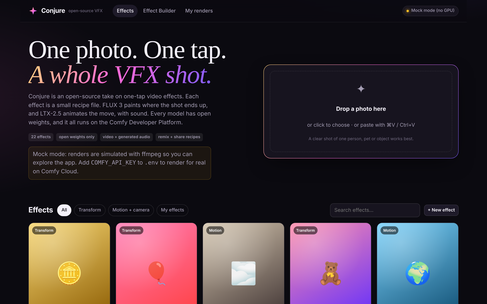
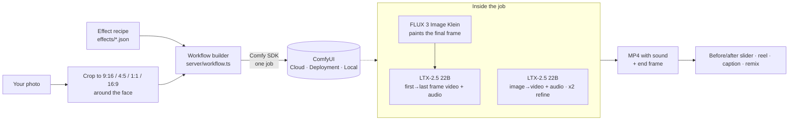

<div align="center">

# ✦ Conjure

**One photo. One tap. A whole VFX shot.**

An open-source rebuild of one-tap viral video effects (gold statue, inflate, disintegrate, earth zoom-out…),
running **only open-weight models** (FLUX 3 Image Klein + LTX-2.5) on the **Comfy Developer Platform**.
Every effect is a small JSON recipe that anyone can remix, share as a link, or contribute with a pull request.

`#OpenSourceHiggsfield` · MIT licensed · Comfy SDK · works on Comfy Cloud, a Comfy API deployment, or your own GPU

</div>

<!-- DEMO: replace with the demo video / GIF once examples are rendered -->
<p align="center"></p>

## Why it's interesting

- **Two-model "transform" pipeline in one Comfy job.** For effects that end somewhere new (gold statue, ice, werewolf…), **FLUX 3 Image Klein** first *paints the final frame* from your photo, then **LTX-2.5** generates the move from *your photo → that frame* (first/last-frame video) **with a matching soundtrack**. Motion effects (disintegrate, crash zoom, bullet time…) go straight to LTX-2.5 image-to-video with a two-stage upscale.
- **Effects are data, not graphs.** A recipe holds the end state, the motion, the camera, and the sound. It never names a node or a model file. The server compiles it into a ComfyUI API graph, so one workflow upgrade improves every effect at once.
- **Describe any effect in one line.** Type *"turn me into a chocolate statue"* and the **Effect Wizard** has **Gemma 4** (an open-weights LLM running *inside ComfyUI*, through the same SDK) write the full recipe. It can also look at your photo to name the subject ("the woman in the yellow raincoat"), which sharpens every prompt.
- **Anyone can make an effect.** The built-in **Effect Builder** lets you write or tweak a recipe, test it on your own photo, then share it as a **link** (the recipe travels inside the URL) or open a **GitHub pull request** that adds it to `effects/` for everyone.
- **Live showcase.** Every push publishes a static version of the app to GitHub Pages. It has every effect with its example render, the before/after slider and the Effect Builder, so anyone can try it without installing anything.
- **Use the effects in plain ComfyUI too.** You get 22 ready-to-run workflows, plus a small custom node pack (**ComfyUI-Conjure**) that turns any recipe into prompts and frame counts inside your own graphs.
- **Open weights only.** No partner nodes or closed APIs. The same code runs on Comfy Cloud, a Comfy API deployment, or a self-hosted ComfyUI through `comfy-api-proxy`.
- **Made to be shared.** Before/after drag slider, one-click vertical **before→after reel**, ready-made caption, 9:16 by default.

## How it works



| Pipeline | Used by | Graph |
|---|---|---|
| **Transform** | effects that end in a new state | `LoadImage → FLUX 3 Klein edit (ReferenceMultiLatent, 16 steps) → SaveImage` and `LTXVAddGuide(first, strength 1.0) + LTXVAddGuide(last, 0.8) → 8-step distilled sampling → LTXVCropGuides → video + audio` |
| **Motion** | particles, superpowers, camera moves | `LTXVImgToVideoInplace → 8 steps at half res → LTXVLatentUpsampler x2 → 3-step refine → video + audio` |

Both graphs were derived from the official ComfyUI templates (`video_ltx2_5_i2v`, `video_ltx2_5_flf2v`, `image_flux3_klein_distilled_image_edit`), converted to API format with the real ComfyUI frontend, and simplified to plain nodes with readable ids (`prompt`, `edit_prompt`, `save_video`…).

## Quick start

Requires **Node 22.9+**. `ffmpeg` is optional (it powers mock renders and the share reel).

```bash
git clone https://github.com/<you>/conjure && cd conjure
npm install
```

### Option A: try it with no GPU (mock mode)

```bash
npm run mock          # opens the UI on http://localhost:5173
```

Mock renders are an ffmpeg pan + dissolve of your photo, so you can try the whole flow (upload, effects, builder, sharing) for free.

### Option B: Comfy Cloud (recommended)

1. Create an API key at **https://platform.comfy.org/profile/api-keys** (needs a Comfy Cloud plan with credits).
2. `cp .env.example .env` and set `COMFY_API_KEY=...`
3. Check the connection, then start:

```bash
npm run doctor        # uploads a tiny image, runs a 3-node workflow, downloads the result
npm run dev           # http://localhost:5173
```

### Option C: your own GPU (self-hosted ComfyUI)

1. Install/update ComfyUI (LTX-2.5 + FLUX 3 nodes are in core) and download the models below into `ComfyUI/models/…`
2. Run ComfyUI, then the official API proxy beside it:

```bash
pip install comfy-api-proxy && comfy-api-proxy run     # serves the Comfy API v2 on :8189
```

3. In `.env`: `COMFY_BASE_URL=http://127.0.0.1:8189`, then `npm run doctor && npm run dev`.

> Production build: `npm run build && npm start` serves the UI and API from one port (http://127.0.0.1:8787).

### Models (all open weights)

| File | Folder | Role |
|---|---|---|
| [`ltx-2.5-22b-distilled-transformer-comfy-int8-convrot`](https://huggingface.co/Lightricks/LTX-2.5) | `diffusion_models` | LTX-2.5 video + audio model |
| [`gemma4-12b-with-proj-ltx-2.5-comfy-int8-convrot`](https://huggingface.co/Lightricks/LTX-2.5) | `text_encoders` | LTX-2.5 text encoder |
| [`ltx-2.5-video-vae-bf16`](https://huggingface.co/Lightricks/LTX-2.5) · [`ltx-2.5-audio-vae-bf16`](https://huggingface.co/Lightricks/LTX-2.5) | `vae` | LTX-2.5 VAEs |
| [`ltx-2.5-latent-spatial-upscaler-x2-bf16-1.0`](https://huggingface.co/Lightricks/LTX-2.5) | `latent_upscale_models` | x2 refine (motion effects) |
| [`flux3_image_klein_sd_int8_convrot`](https://huggingface.co/black-forest-labs/flux-3-image-klein-comfy) | `diffusion_models` | FLUX 3 Image Klein (end frame) |
| [`qwen3vl_4b_int8_convrot`](https://huggingface.co/black-forest-labs/flux-3-image-klein-comfy) | `text_encoders` | FLUX 3 text encoder |
| [`flux2-vae`](https://huggingface.co/black-forest-labs/flux-3-image-klein-comfy) | `vae` | FLUX VAE |
| [`gemma4_e4b_it_fp8_scaled`](https://huggingface.co/Comfy-Org/gemma-4) | `text_encoders` | Gemma 4 E4B, the Effect Wizard (optional) |

Exact download URLs are in [`workflows/models.json`](workflows/models.json). The `workflows/ui/*.json` files carry them too, so ComfyUI's "missing models" dialog can fetch them. Both Hugging Face repos are gated, so accept the terms there first. Licenses: LTX-2.x Community License (Lightricks), the FLUX 3 Image Klein license (Black Forest Labs) and the Gemma license (Google).

## The effects

| Effect | What happens | Models | id |
|---|---|---|---|
| 🪙 **Midas Touch** | Liquid gold creeps over you until you're a solid gold statue. | FLUX 3 → LTX-2.5 | `midas-touch` |
| 🎈 **Inflate** | Puff up like a balloon and float off the ground. | FLUX 3 → LTX-2.5 | `inflate` |
| 🌫️ **Dust to Dust** | Disintegrate into ash that drifts away on the wind. | LTX-2.5 | `dust-to-dust` |
| 🧸 **Boxed Figure** | Shrink into a collectible action figure sealed in its box. | FLUX 3 → LTX-2.5 | `boxed-figure` |
| 🌍 **Earth Zoom Out** | Rocket back from your face to orbit in one shot. | LTX-2.5 | `earth-zoom-out` |
| 🤖 **Chrome Reveal** | Your skin peels away to reveal the android underneath. | FLUX 3 → LTX-2.5 | `chrome-reveal` |
| 🗿 **Turn to Stone** | Cracks race across your skin and you petrify into a marble statue. | FLUX 3 → LTX-2.5 | `turn-to-stone` |
| 🔥 **Ignite** | Your hands burst into controlled superhero flames. | LTX-2.5 | `ignite` |
| 🧊 **Deep Freeze** | Frost spreads until you're a glittering ice sculpture. | FLUX 3 → LTX-2.5 | `deep-freeze` |
| ⏱️ **Bullet Time** | Time freezes while the camera orbits around you. | LTX-2.5 | `bullet-time` |
| 🐺 **Full Moon** | A werewolf transformation, howl included. | FLUX 3 → LTX-2.5 | `full-moon` |
| 🪽 **Angel Wings** | Huge feathered wings unfold from your back. | LTX-2.5 | `angel-wings` |
| 🏺 **Clay Day** | Become a handmade stop-motion clay character. | FLUX 3 → LTX-2.5 | `clay-day` |
| 🌀 **Portal Out** | A glowing portal tears open and you step through. | LTX-2.5 | `portal-out` |
| ✏️ **Toon Shift** | The world redraws itself as a hand-drawn anime frame. | FLUX 3 → LTX-2.5 | `toon-shift` |
| ⚡ **Thunder Call** | Summon lightning that crackles around you. | LTX-2.5 | `thunder-call` |
| 📄 **Origami** | Fold into a crisp paper origami sculpture. | FLUX 3 → LTX-2.5 | `origami` |
| 🪐 **Zero Gravity** | Gravity switches off and everything floats. | LTX-2.5 | `zero-gravity` |
| 👾 **8-Bit** | Glitch into a retro pixel-art sprite. | FLUX 3 → LTX-2.5 | `eight-bit` |
| 🎯 **Crash Zoom** | A dramatic crash zoom straight into your eyes. | LTX-2.5 | `crash-zoom` |
| 🎉 **Confetti Pop** | Burst into a cloud of party confetti. | LTX-2.5 | `confetti-pop` |
| 🫠 **Meltdown** | Melt into a glossy puddle like wax in the sun. | LTX-2.5 | `meltdown` |
## Make your own effect

The fastest way is to type the idea into **"Imagine any effect…"**. Gemma 4 drafts the recipe and opens it in the builder for you. Or open **Effect Builder** and write it yourself, or write a file in `effects/`:

```json
{
  "id": "midas-touch",
  "name": "Midas Touch",
  "tagline": "Liquid gold creeps over you until you're a solid gold statue.",
  "icon": "🪙",
  "colors": ["#f7d774", "#8a5a00"],
  "pipeline": "transform",
  "subject": "the person",
  "endFrame": "Convert {subject} into a solid statue cast in polished 24-karat gold … Keep the exact same pose, framing …",
  "motion": "{subject} stands still as a bead of molten gold appears at their fingertips. Liquid gold spreads up the arms …",
  "sound": "a rising shimmering metallic hum, soft liquid pouring, and a final bright resonant chime",
  "duration": 5
}
```

| Field | Meaning |
|---|---|
| `pipeline` | `transform` (FLUX 3 end frame → LTX-2.5 morph) or `motion` (LTX-2.5 image-to-video) |
| `endFrame` | *transform only.* Image-edit instruction for the final frame. Describe the end state concretely, then say what stays the same. |
| `motion` | What happens, in order, plus the camera and the light. Conjure adds the first/last-frame preamble for you. |
| `sound` | LTX-2.5 generates the soundtrack together with the video. |
| `subject` | Default meaning of `{subject}`. Users can override it at render time ("my dog"). |
| `strength.start` / `strength.end` | How strongly the photo pins the first frame / the end frame pins the last (optional) |
| `loras` | Optional `[{ "name": "file.safetensors", "strength": 0.8, "target": "video" | "image" }]`, spliced after the model loader |

The full schema with validation lives in [`server/effects.ts`](server/effects.ts). Share an effect three ways:

1. **Link:** "Copy effect link" puts the whole recipe in the URL. Anyone running Conjure can open it in the builder.
2. **Pull request:** set `CONJURE_GITHUB_REPO=you/conjure` and "Submit to community" opens GitHub's new-file page with the recipe pre-filled.
3. **File:** download the `.json` and drop it into `effects/` (or into the ComfyUI node pack).

## Use it inside ComfyUI

- `workflows/effects/<effect>.json`: one ready-to-run API-format workflow per effect (9:16, 5 s). Drag it into ComfyUI, pick your photo in **Conjure: input photo**, and queue.
- `workflows/ui/*.json`: the two base pipelines, laid out in groups with model download links.
- `comfy-nodes/ComfyUI-Conjure`: copy it into `ComfyUI/custom_nodes/` to get the **Conjure Effect Recipe ✦** node. It outputs `motion_prompt`, `end_frame_prompt`, `negative_prompt`, `frames` and `fps` for any bundled or pasted recipe, so effects drop into your own graphs. Its output matches the app's prompt builder byte for byte (this is tested). Example graphs are in `example_workflows/`.

## Scripts

| Command | What it does |
|---|---|
| `npm run dev` / `npm run mock` | UI on :5173 + API on :8787 (live reload) / same, with simulated renders |
| `npm run build && npm start` | Production: one server on :8787 |
| `npm run build:showcase` | Static live showcase for GitHub Pages (`.github/workflows/pages.yml` deploys it on every push) |
| `npm run doctor` | Checks your Comfy backend with a tiny 3-node job |
| `npm run samples` | Generates synthetic sample photos with FLUX 3 (no real people's likeness) |
| `npm run examples` | Renders every effect into `examples/<id>/` for the gallery previews (`--only=…`, `--quality=draft`, `--force`) |
| `npm run validate` | Builds all 22 effects × 4 aspects × 2 qualities and checks them against ComfyUI node schemas, offline |
| `npm test` | Unit + API tests (mock backend) |
| `npm run export-workflows` / `npm run sync-nodes` | Regenerate `workflows/effects/` / copy recipes into the node pack |

## Project layout

```
effects/            22 recipes (+ _order.json for gallery order)
shared/             the recipe schema (used by server and browser)
workflows/          base API graphs, node-schemas.json snapshot, models.json, effects/, ui/
server/             Hono API: workflow builder, Comfy SDK runner, Effect Wizard (Gemma 4), mock runner, ffmpeg reel
web/                React UI: gallery, effect sheet, before/after compare, Effect Builder, renders
comfy-nodes/        ComfyUI-Conjure custom node pack
scripts/            doctor, samples, examples, validate, export
test/               vitest
docs/               how it works, demo script, submission checklist
```

## How it was verified

- All 176 workflow builds (22 effects × 4 aspects × 2 qualities, plus a LoRA-spliced variant) were submitted to a real, current ComfyUI (`/prompt` validation), and all passed. CI-friendly offline checks run against `workflows/node-schemas.json`.
- The SDK path (upload → submit → events → outputs → download) was exercised end to end against ComfyUI through `comfy-api-proxy`.
- The ComfyUI-Conjure node was loaded and executed in ComfyUI. Its prompts match the app's for every effect.
- The Effect Wizard graph (Gemma 4 → `SaveText`) passes ComfyUI validation, and text outputs come back through the SDK. Messy LLM replies are repaired into valid recipes (tested).

## Credits

Built with [ComfyUI](https://github.com/Comfy-Org/ComfyUI) and the [Comfy SDK](https://docs.comfy.org/development/api-development/sdks), using [LTX-2.5](https://huggingface.co/Lightricks/LTX-2.5) by Lightricks and [FLUX 3 Image Klein](https://huggingface.co/black-forest-labs/flux-3-image-klein-comfy) by Black Forest Labs. Effect names are original. No third-party characters, brands or likenesses are used, and the sample photos are synthetic. Built for the Comfy **Open Source Higgsfield** challenge. Inspired by one-tap effect apps; not affiliated with Higgsfield.

MIT © Conjure contributors
